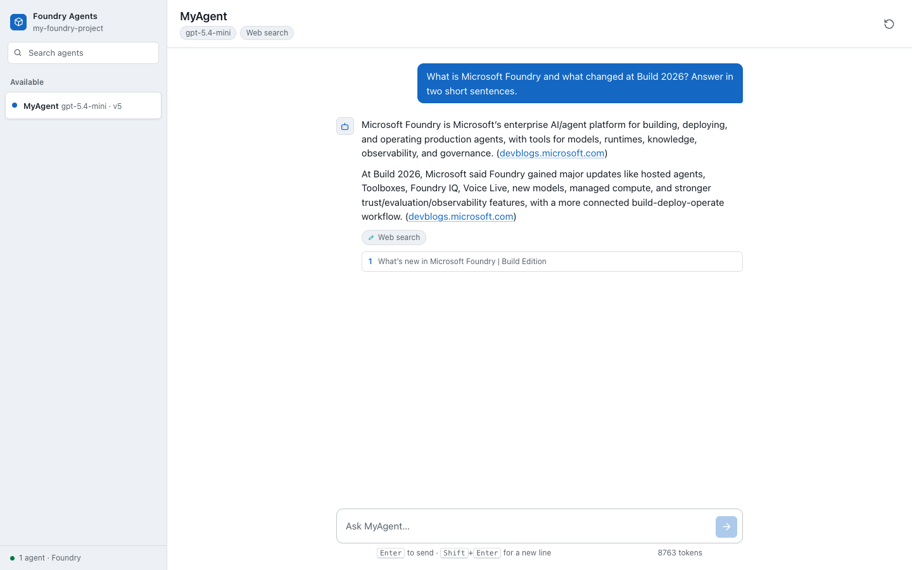
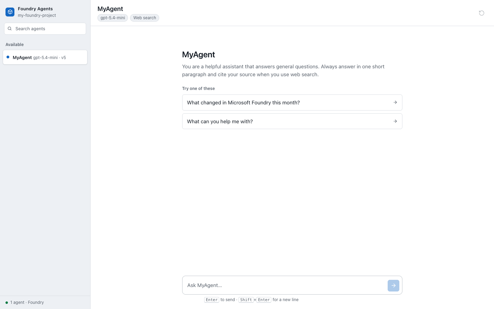
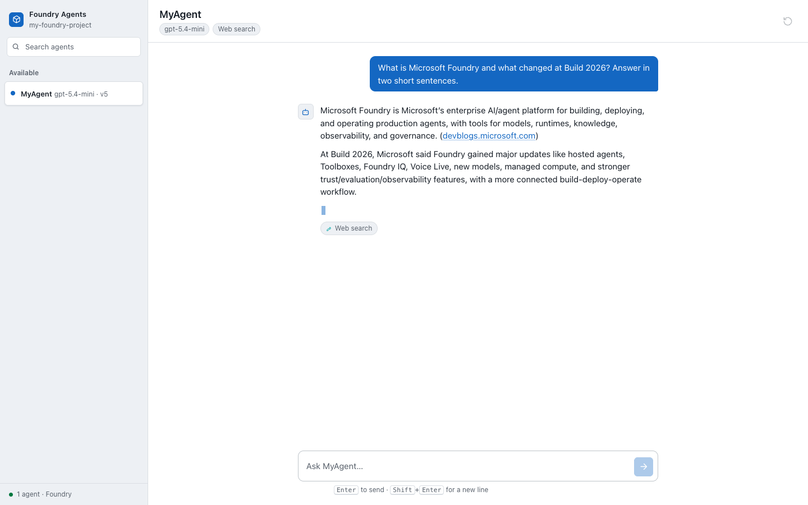
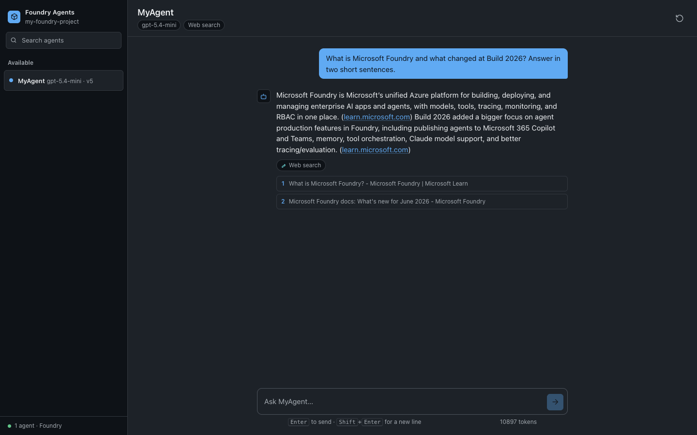
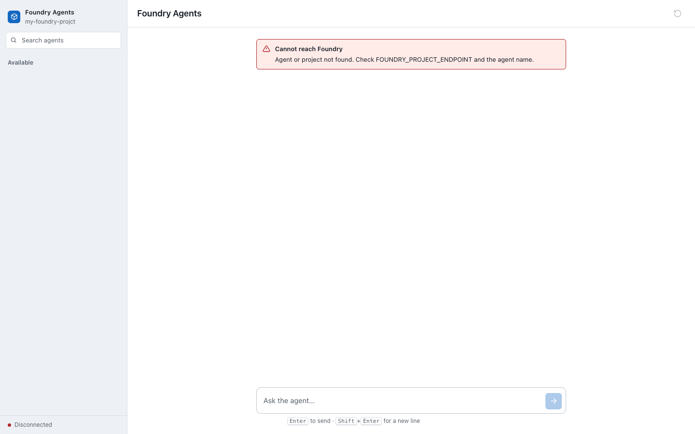

<!-- jr-brand:start -->
<div align="center">
  <a href="https://jannikreinhard.com/">
    
  </a>
  <h1>Microsoft Foundry Agent Tab</h1>
  <p><strong>Chat with your Microsoft Foundry agents from a Microsoft Teams tab. Streaming answers, tool chips, citations, real errors. Sample code for the book &#x27;Microsoft Foundry&#x27;.</strong></p>
  <p>
  <a href="https://jannikreinhard.com/"></a>
  <a href="https://github.com/JayRHa"></a>
  <a href="https://www.linkedin.com/in/jannik-r/"></a>
  <a href="https://x.com/jannik_reinhard"></a>
  <a href="https://www.youtube.com/@jannikreinhard"></a>
  </p>
  <p><sub>Driving AI with passion · Microsoft Foundry · Intune · Azure</sub></p>
</div>
<!-- jr-brand:end -->

## Overview

A Microsoft Teams personal tab for chatting with the agents in a **Microsoft Foundry**
project. It lists the agents the project actually exposes, streams answers token by
token, shows which tools the agent ran, and puts a source under every grounded claim.

Companion sample for the book **Microsoft Foundry** by [Jannik Reinhard](https://jannikreinhard.com).
Everything here runs against a real Foundry project — there is no mock mode and no
canned data.



## Why This Exists

Publishing an agent to Teams through the Foundry portal gives you a bot. That is the
right answer for most people. This is the other answer: a tab you own, where you decide
what the surface shows — including the parts a bot chat hides. The tool the agent ran,
the sources behind the sentence, the token cost of the turn, and the real reason a call
failed are all first-class here, because those are the things you need when an agent
misbehaves in front of a user.

## What It Does

- **Agent picker** built from `GET /agents` on the project. No hardcoded agent list —
  what you see is what the project has, including model and tools per agent.
- **Streaming answers** over Server-Sent Events. The caret keeps moving, so a slow
  grounded answer never looks like a hang.
- **Tool chips.** When the service runs web search, file search, or a function, the tab
  says so. Agent behaviour stops being a black box.
- **Citations** with real, clickable URLs from the response annotations.
- **Real errors.** 401 (not signed in), 403 (no role), 404 (wrong endpoint), 429
  (quota), and content-filter blocks each get their own honest sentence instead of
  "Something went wrong."
- **Three Teams themes** — default, dark, and high contrast — driven by the Teams
  client, not by the tab.
- **No secrets in the browser.** The token lives on the server. See [Architecture](#architecture).

## Screenshots

| | |
|---|---|
| **Empty state** — teaches the agent and offers starters that actually run<br> | **Streaming** — tokens arrive, caret alive<br> |
| **Dark theme** — the Teams client decides, the tab follows<br> | **Error** — the real cause, not a shrug<br> |

## Architecture

```
Teams client
    │  loads the tab over HTTPS, hands it the theme
    ▼
app/           static page — no framework, no build step, no token
    │  GET /api/agents          POST /api/chat  (Server-Sent Events)
    ▼
server/        Express — holds the credential, talks to Foundry
    │  Authorization: Bearer <token for https://ai.azure.com/.default>
    ▼
Microsoft Foundry project
    ├── GET  {project}/agents?api-version=v1        control surface
    ├── POST {project}/openai/v1/conversations      OpenAI-compatible surface
    └── POST {project}/openai/v1/responses          (streams SSE back)
```

The backend exists for exactly one reason: **a Teams tab is a web page, and anything a
web page holds, the user holds.** Put a Foundry key in the frontend and you have handed
every user of the tab full access to the project. The server keeps the credential and
exposes two narrow endpoints instead.

Auth is `DefaultAzureCredential`, so the same code runs under `az login` on your laptop
and under a managed identity in App Service. There is no API key anywhere in this repo.

## Three things the API will trip you on

These cost real time to find. They are documented here so they cost you none.

**1. One project endpoint, two surfaces, two versioning rules.**

```
{project}/agents?api-version=v1     ✅ control surface — wants api-version
{project}/openai/v1/responses       ✅ OpenAI-compatible — rejects it outright
{project}/openai/v1/responses?api-version=v1
                                    ❌ "api-version=v1 is not allowed. Use /v1 path instead."
```

**2. `agent` is deprecated; it is `agent_reference` — and `type` is required inside it.**

```jsonc
// ❌ rejected as deprecated
{ "agent": "MyAgent" }

// ❌ rejected: type is missing
{ "agent_reference": { "name": "MyAgent" } }

// ✅
{ "agent_reference": { "name": "MyAgent", "type": "agent_reference" } }
```

**3. Two roles look like one.** `Azure AI Agent Consumer` grants
`.../endpoints/interact/action`. `Azure AI Project Runtime User` grants
`.../responses/*`. Reading the agent list and calling the agent are separate
permissions — a tab that lists agents but 403s on send is almost always this.

## Run it locally

Requires Node 20+, the Azure CLI, and a Foundry project with at least one agent.

```bash
az login                       # the identity needs a Foundry role on the project
cd server
npm install
cp .env.example .env           # then set FOUNDRY_PROJECT_ENDPOINT
npm start
```

Open <http://localhost:3978>. Outside Teams the tab falls back to your OS colour
scheme; append `?theme=dark` or `?theme=contrast` to force one.

`FOUNDRY_PROJECT_ENDPOINT` is the project endpoint from the Foundry portal overview:

```
https://<resource>.services.ai.azure.com/api/projects/<project>
```

### Roles you need

| Role | Why |
|---|---|
| `Azure AI Foundry User` | read the project |
| `Azure AI Agent Consumer` | list agents |
| `Azure AI Project Runtime User` | create conversations and responses |

## Run it in Teams

Teams only loads a tab over HTTPS, so during development point a tunnel at port 3978:

```bash
devtunnel host -p 3978 --allow-anonymous     # or ngrok http 3978
cd teams
./package.sh <your-tunnel-host>              # bare hostname, no scheme
```

Then in Teams: **Apps → Manage your apps → Upload an app → Upload a custom app**, and
pick `teams/foundry-agent-tab.zip`. Uploading custom apps must be allowed by your
tenant's app setup policy.

The manifest ships with a `__TAB_DOMAIN__` placeholder that `package.sh` substitutes,
so nobody accidentally commits their tunnel hostname.

## Layout

```
app/                the tab — index.html, styles.css, app.js, favicon.svg
server/             Express backend + Foundry calls
teams/              manifest.json, icons, package.sh
docs/screenshots/   the screenshots above
PRODUCT.md          who this is for and what it refuses to be
DESIGN.md           the visual system: themes, colour, type, motion
```

No build step, no bundler, no framework. The tab is three files a reader of the book can
open and understand in one sitting, which is the whole point.

## Related

- 📕 The book: **Microsoft Foundry** — Jannik Reinhard
- 💻 All code from the book: [foundry-book-code](https://github.com/JayRHa/foundry-book-code)
- 🌐 [jannikreinhard.com](https://jannikreinhard.com)

## License

MIT — see [LICENSE](LICENSE).

<!-- jr-brand-footer:start -->

---

<div align="center">
  <p><sub>Built and maintained by <a href="https://jannikreinhard.com/">Jannik Reinhard</a> · Microsoft MVP for Security and AI Platform.</sub></p>
  <p><a href="https://www.buymeacoffee.com/jannikreinf">Support the open-source work</a></p>
  <p><strong>Stay healthy, Cheers Jannik</strong></p>
</div>

<!-- jr-brand-footer:end -->
